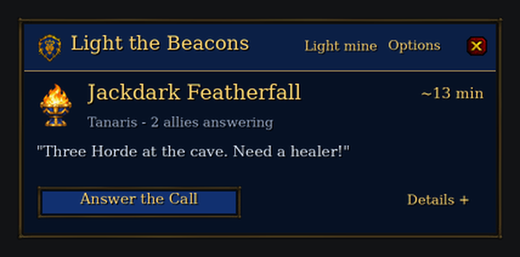

# Light the Beacons

A guild rescue addon for **World of Warcraft: Forever (interface 16001)**.
Sound a war horn and call your guildmates to your aid, with estimated routes
based on each responding character’s discovered flight points and trained riding tier.

**[Download the latest addon ZIP](https://github.com/TLT26-churn/LightTheBeacons/releases/latest)** ·
[Full guide](LightTheBeacons/README.md) · [Release notes](CHANGELOG.md)

## Install on Windows or Linux

Use the same `LightTheBeacons-<version>.zip` on **Windows** and **Linux with
Wine/Proton**. Extract its `LightTheBeacons` folder into your WoW installation’s
`_forever_/Interface/AddOns/` directory. The final file must be:

```
_forever_/Interface/AddOns/LightTheBeacons/LightTheBeacons.toc
```

Enable Light the Beacons in the game’s AddOns list. Restart WoW if a newly
installed addon is absent; use `/reload` when updating an existing installation.
Open with **`/ltb`** or the minimap brazier. Open a flight master's map to confirm
your available flight points; repeat on other continents you use. Every
participating guildmate needs the addon. Keep your SavedVariables when updating.

## What it does

- Sends alerts only through the hidden guild addon channel. **No guild chat posts.**
- Shows “The beacons are lit! <Name> calls for aid!” with WoW’s native Horn of Cenarius / Dwarf Horn.
- Provides a compact Alliance Rally card, original royal brazier, lion crest,
  expandable numbered routes, map pins and a direction guide.
- Celebrates your first responder with a gold lion flare and an Alliance fanfare. More allies update the count.
- Compares ground travel, flight-master-confirmed flights, boats and zeppelins for each responder.
- Supports private responses, extinguishing calls and five-minute beacon expiry.
- Shares guild addon users' positions about every 10 seconds, even without a
  beacon, on zone, continent and full Azeroth maps. **Sharing defaults to on**;
  each player can turn it off in Options → Map & beacon controls.
- Shows a movable brazier button by default, with individual filters to silence
  or hide beacons, hide someone's location, or hide all shared locations.
- Lets callers add a short message and save three quick templates per character.
  Messages appear on allies' alerts, beacon cards and map-pin tooltips.
- Offers optional automatic PvP death alerts when the client exposes readable
  evidence of a hostile player’s killing blow. Automatic alerts default to off;
  a manual death prompt is available when attribution is restricted.

**1.4.0:** your own call confirms in the Rally card without a popup. Response
celebrations and incoming alerts no longer overlap. The floating brazier is on
by default; hide it in **Options → Map & beacon controls**. Left-click to ignite/extinguish,
Shift-drag to move, and right-click for the full card. **Player filters** offers
Normal, Silence and Hide for beacons, plus a separate Hide location checkbox.
Both guildmates need 1.4.0 for background location sharing; stale markers expire
after 45 seconds. Alliance lion markers show locations; braziers show beacons.

The compact Rally card keeps the caller, message and answer action at
hand. **Details** reveals the route, map and responders; answering adds a short
next-step strip. Your own call offers **Extinguish My Beacon**. The author credit
is tucked into **Options**, and the original royal brazier ships with the addon.



**Messages:** choose **Light mine** or `/ltb light`, type an optional message
(up to 48 characters), or select one of your three saved messages. Click **Save
current** to store a template, then **Light the Beacons** to send the call.
Automatic PvP alerts remain immediate and do not reuse drafts or templates.
Guildmates need 1.2.0 to see the custom text; earlier versions still receive the
beacon and route normally.

**1.2.1:** fixes self-navigation from your own alert and plays the deep horn
directly from WoW's native asset. `/ltb horn` tests it; `/ltb sound` shows diagnostics.


The Alliance design includes a native WoW horn, a first-responder celebration,
verified flight discovery, and automatic riding detection.


**1.0.3:** automatically uses the character’s trained 60%/100% riding tier, or
walking speed when untrained. Options includes an on-foot override.

**1.0.2:** fixes routes to undiscovered flight points such as Gadgetzan. The old
unreliable discovery cache is reset once; settings and flight timings are kept.
Visit a flight master after updating to rebuild the confirmed list.

Routes are estimates rather than terrain-aware GPS. The addon does not account
for hearthstones, teleports or summons, and never moves your character for you.
Automatic PvP attribution, guild delivery and shared map positions still require live multiplayer
verification; simulated-client checks cannot establish those live behaviors.

## Development

The runtime is ordinary WoW Lua/XML with bundled TGA artwork and native WoW sound references. Players do
not need Python, LuaJIT or any other external program.

To run the headless tests, install LuaJIT. Packaging also requires a Lua compiler
(`luac`), Python 3 and Pillow:

```sh
luajit tests/light-beacons.lua LightTheBeacons
python3 tools/package_light_beacons.py
```

The packager validates Lua syntax, media hashes, bindings, archive paths and an
extracted copy with simulated clients, then creates one portable ZIP. The tests
cover private delivery, templates, Unicode messages, reordered packets, malformed messages, cooldowns, discovery isolation,
routes, death attribution, reload/login startup, notification overlap, floating
controls, per-player filters, location privacy/expiry and world-map projection.

Optional `tools/build_light_beacons_media.py` restores missing artwork from pinned sources. The preview renderer
accepts `LTB_PREVIEW_FONT` if its default serif fonts are unavailable.

## Credits

By **Whitebeard Tinkerton — US PVP**. Flight data is adapted from Daniel Costa’s
[Lodestar](https://github.com/danielcosta42/lodestar); its MIT license and source
record are included under `LightTheBeacons/ThirdParty/`. The original royal brazier
was created for this addon with OpenAI image generation; its source and prompt
are under `art/`. Blizzard UI artwork remains Blizzard Entertainment’s property; pinned source URLs and
hashes are in `LightTheBeacons/Media/sources.json`. Sounds play from Blizzard’s native
client sound assets, with sound-kit fallback; no recordings are bundled. This project is not affiliated with Blizzard.
