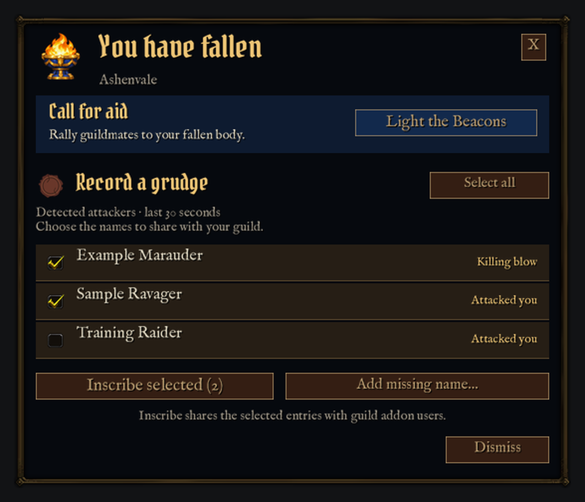
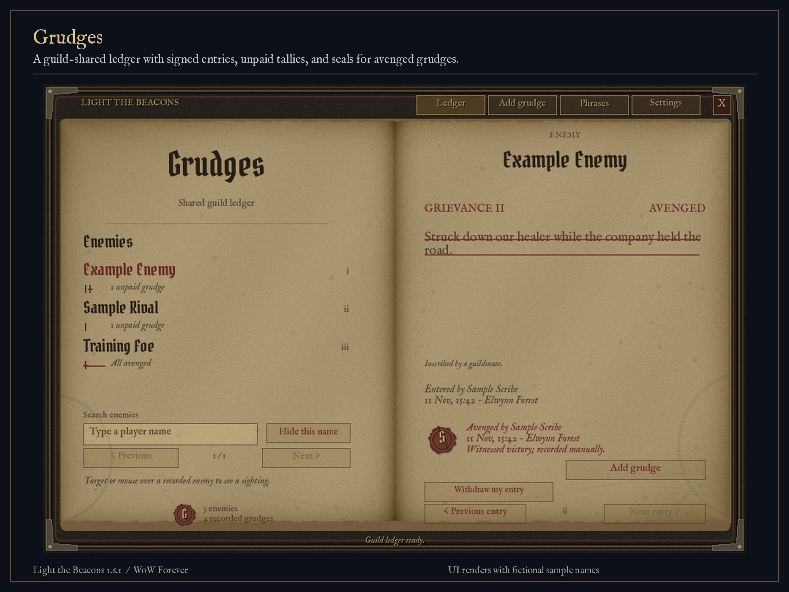
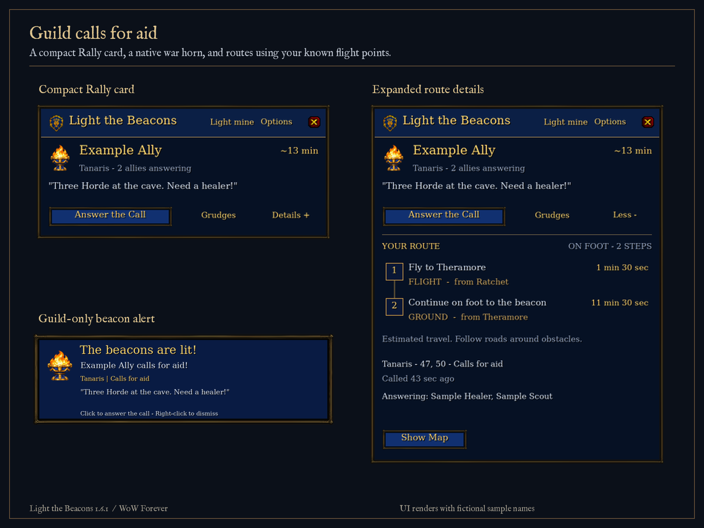
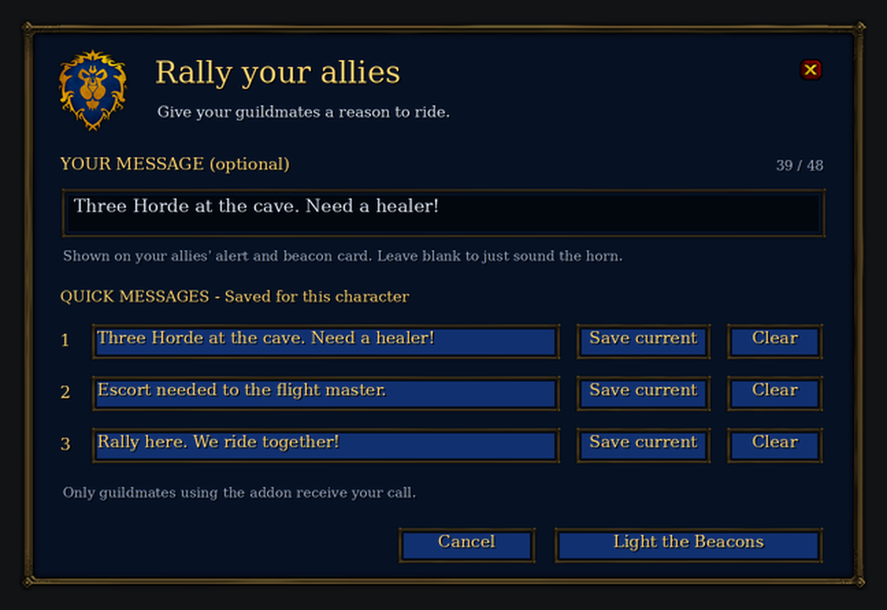
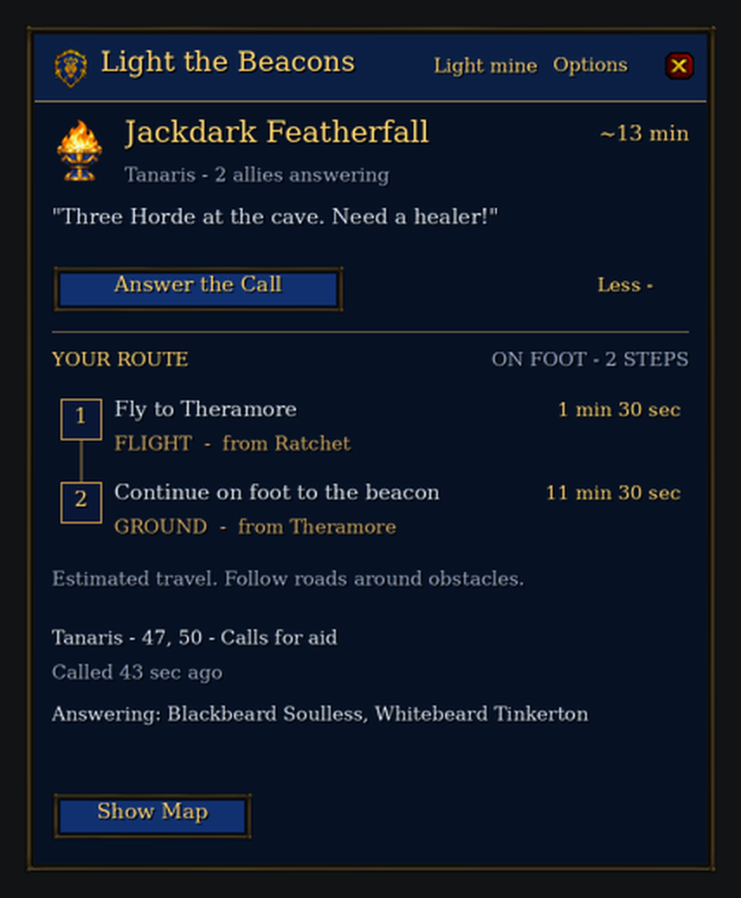
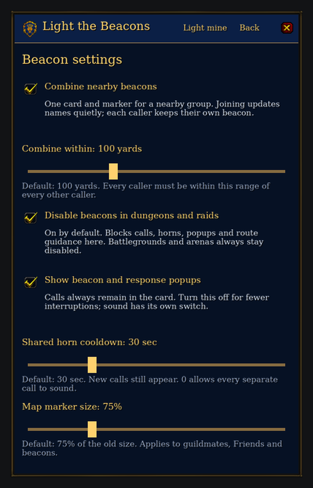

# Light the Beacons

A guild rescue addon for **World of Warcraft: Forever (interface 16001)**.
Sound a war horn and call your guildmates to your aid, with estimated routes
based on each responding character’s discovered flight points and trained riding tier.

**Version 1.6.4** adds configurable local chat notices for beacon
activity and guild grudges. Nearby joins and sightings stay quiet by default.
It includes nearby-call combining, a shared horn cooldown, smaller map markers
and PvP death actions beside Blizzard's controls.
See the [validation guide](docs/DEATH-CLIENT-TEST.md).

**[CurseForge](https://www.curseforge.com/wow/addons/light-the-beacons)** ·
[GitHub downloads](https://github.com/TLT26-churn/LightTheBeacons/releases/latest) ·
[Full guide](LightTheBeacons/README.md) · [Release notes](CHANGELOG.md)

## Install on Windows or Linux

Use the same `LightTheBeacons-<version>.zip` on **Windows** and **Linux with
Wine/Proton**. Extract its `LightTheBeacons` folder into your WoW installation’s
`_forever_/Interface/AddOns/` directory. The final file must be:

```
_forever_/Interface/AddOns/LightTheBeacons/LightTheBeacons.toc
```

Enable Light the Beacons in the game’s AddOns list. Restart WoW if a newly
installed addon is absent; use `/reload` when updating an existing installation.
Open with **`/ltb`** or the minimap brazier. Open a flight master's map to confirm
your available flight points; repeat on other continents you use. Every
participating guildmate needs the addon. Keep your SavedVariables when updating.

## What it does

- **1.6.4** adds local chat notices naming beacon callers, responders and
  grudge authors. Four switches under **Options → Chat notices** (`/ltb chat`)
  control beacon activity, nearby joins, grudge activity and enemy sightings.
  Global mute and personal filters apply; nothing is posted to guild chat.

- **1.6.3** adds configurable nearby-call combining (100 yards), a shared
  horn cooldown (30 sec), smaller adjustable map markers (75%), a popup switch,
  and default dungeon/raid suppression. Joining a group never sounds or creates
  a new notification. Individual callers retain their own beacon and message.
  It also fixes descending map projection and removes sound-test/preview controls.
  Open **Options → Beacon settings** or `/ltb settings`.

- **1.6.3** combines guild death actions beside the original death window: call for aid, select
  detected attackers, and inscribe selected grudges. Confirmed killing blows
  are distinguished from other attackers; beacon and ledger actions stay independent.
- **1.6.2** adds the missing post-death grudge prompt. Review a prefilled killer
  when attribution is readable, or enter a name yourself when it is unavailable.
  Grudges → Settings offers **Ask first** (default), **Auto-save**, and **Off**.
- **1.6.1** makes the Grudges ledger clearer: outlined inputs with typing hints,
  framed action buttons, concise default alerts and a single fantasy title.

- Version 1.6.0 adds a **guild-shared Book of Grudges**. Open it from the Rally
  card or with `/ltb grudges`: an aged, iron-bound ledger with signed grievances,
  scratched tallies, page turning and wax seals for avenged debts. Guildmates
  synchronize missed history when they are online together.
- Version 1.5.0 adds **Mute all beacon alerts**, private **Friend** marks,
  and **Show only Friends on the map**. Friends use the native Alliance shield;
  regular guildmates keep the existing Alliance lion. These controls leave guild
  location sharing independent.
- Sends alerts only through the hidden guild addon channel. **No guild chat posts.**
- Shows “The beacons are lit! <Name> calls for aid!” with WoW’s native Horn of Cenarius / Dwarf Horn.
- Provides a compact Alliance Rally card, original royal brazier, lion crest,
  expandable numbered routes, map pins and a direction guide.
- Celebrates your first responder with a gold lion flare and an Alliance fanfare. More allies update the count.
- Compares ground travel, flight-master-confirmed flights, boats and zeppelins for each responder.
- Supports guild-only responses, extinguishing calls and five-minute beacon expiry.
- Shares guild addon users' positions about every 10 seconds, even without a
  beacon, on zone, continent and full Azeroth maps. **Sharing defaults to on**;
  each player can turn it off in Options → Map & beacon controls.
- Shows a movable brazier button by default, with individual filters to silence
  or hide beacons, hide someone's location, or hide all shared locations.
- Lets callers add a short message and save three quick templates per character.
  Messages appear on allies' alerts, beacon cards and map-pin tooltips.
- Offers optional automatic PvP death alerts when the client exposes readable
  evidence of a hostile player’s killing blow. Automatic alerts default to off;
  manual calls and ledger entries remain available when attribution is restricted.



**1.4.0:** your own call confirms in the Rally card without a popup. Response
celebrations and incoming alerts no longer overlap. The floating brazier is on
by default; hide it in **Options → Map & beacon controls**. Left-click to ignite/extinguish,
Shift-drag to move, and right-click for the full card. **Friends & filters** offers
Normal, Silence and Hide for beacons, plus a separate Hide location checkbox.
Both guildmates need 1.4.0 for background location sharing; stale markers expire
after 45 seconds. Alliance lion markers show locations; braziers show beacons.

The compact Rally card keeps the caller, message and answer action at
hand. **Details** reveals the route, map and responders; answering adds a short
next-step strip. Your own call offers **Extinguish My Beacon**. The author credit
is tucked into **Options**, and the original royal brazier ships with the addon.





**Messages:** choose **Light mine** or `/ltb light`, type an optional message
(up to 48 characters), or select one of your three saved messages. Click **Save
current** to store a template, then **Light the Beacons** to send the call.
Automatic PvP alerts remain immediate and do not reuse drafts or templates.
Guildmates need 1.2.0 to see the custom text; earlier versions still receive the
beacon and route normally.

**1.2.1:** fixes self-navigation from your own alert and plays the deep horn
directly from WoW's native asset. `/ltb sound` shows read-only diagnostics.



The Alliance design includes a native WoW horn, a first-responder celebration,
verified flight discovery, and automatic riding detection.



**1.0.3:** automatically uses the character’s trained 60%/100% riding tier, or
walking speed when untrained. Options includes an on-foot override.

**1.0.2:** fixes routes to undiscovered flight points such as Gadgetzan. The old
unreliable discovery cache is reset once; settings and flight timings are kept.
Visit a flight master after updating to rebuild the confirmed list.

Routes are estimates rather than terrain-aware GPS. The addon does not account
for hearthstones, teleports or summons, and never moves your character for you.
Automatic PvP attribution, guild delivery and shared map positions still require live multiplayer
verification; simulated-client checks cannot establish those live behaviors.

## Beacon settings

Open `/ltb settings` to adjust combining, range, horn cooldown, map marker size,
popup visibility and dungeon/raid behavior. Preferences are saved per character.



## Development

The runtime is ordinary WoW Lua/XML with original brazier/tome artwork, bundled
OFL fonts and native WoW texture/sound references. Players do
not need Python, LuaJIT or any other external program.

To run the headless tests, install LuaJIT. Packaging also requires a Lua compiler
(`luac`), Python 3 and Pillow:

```sh
luajit tests/light-beacons.lua LightTheBeacons
python3 tools/package_light_beacons.py
```

The packager validates Lua syntax, media hashes, bindings, archive paths and an
extracted copy with simulated clients, then creates one portable ZIP. The tests
cover private delivery, templates, Unicode messages, reordered packets, malformed messages, cooldowns, discovery isolation,
routes, death attribution, reload/login startup, notification overlap, floating
controls, per-player filters, location privacy/expiry and world-map projection.
Ledger checks cover fragmented UTF-8 records, guild and author validation,
reordered/duplicate history, offline multi-page sync, withdrawals, combat
attribution, one-kill/one-debt settlement, retention and native book controls.

Optional `tools/build_light_beacons_media.py` restores the original brazier and caches native texture references locally for previews. The preview renderer
accepts `LTB_PREVIEW_FONT` if its default serif fonts are unavailable.
`tools/build_grudge_media.py` reproduces the original worn-tome and wax textures.
The book uses the bundled Pirata One and IM Fell English fonts, with their
unaltered SIL Open Font License notices and source hashes in `LightTheBeacons/Fonts/`.

## Credits

By **Whitebeard Tinkerton — US PVP**. Flight data is adapted from Daniel Costa’s
[Lodestar](https://github.com/danielcosta42/lodestar); its MIT license and source
record are included under `LightTheBeacons/ThirdParty/`. The original royal brazier
was created for this addon with OpenAI image generation; its source and prompt
are under `art/`. Blizzard UI artwork remains in the installed client and belongs to Blizzard Entertainment; native references and preview source records are in `LightTheBeacons/Media/sources.json`. Sounds play from Blizzard’s native
client sound assets, with sound-kit fallback; no recordings are bundled. This project is not affiliated with Blizzard.

## License and privacy

All Rights Reserved with Free Player Use: players may download, install, run and
make personal backups at no cost. Redistribution, resale and publication of
modified original code require separate permission. See [LICENSE.txt](LICENSE.txt).
Third-party materials retain their own rights, including Lodestar’s MIT license.

**Location sharing is on by default.** Guild members can receive and record addon
packets, including beacon messages and responses. Local player filters are not
recipient blocks. Read [PRIVACY.txt](LightTheBeacons/PRIVACY.txt) for transmitted fields,
local saves, retention and instructions to stop sharing.
