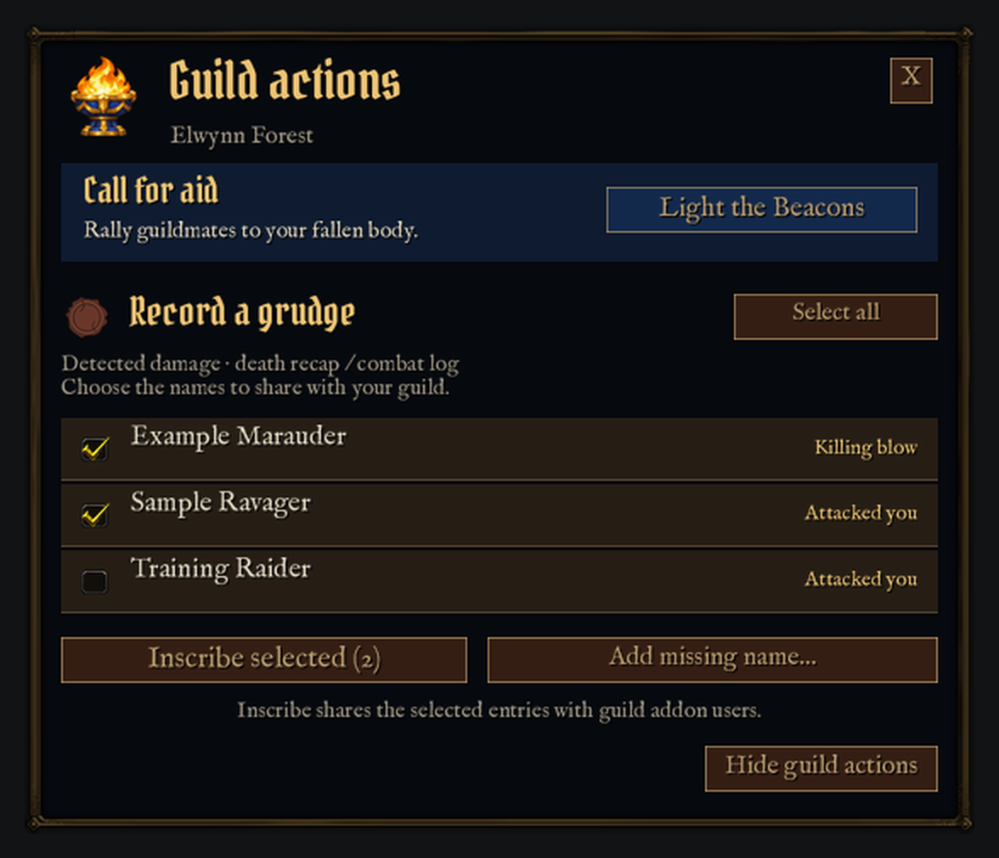

# Death-window client test

Branch: `codex/death-client-test` · Build: `1.6.3-test.1`

This is a local test build, not a GitHub/CurseForge release. Main is unchanged.
The native-window takeover in the earlier design render is not enabled.
This implementation keeps Blizzard's real controls and attaches guild actions
underneath. It never hides, reparents, resizes, skins, replaces callbacks on, or
programmatically clicks the native popup or its buttons. Protected controls,
release restrictions, self-resurrection options and existing skins remain native.

The extension moves beside the native dialog if there is insufficient space
below. If it cannot read the dialog's geometry or fit safely, it hides itself
and keeps retrying while that death review is active. The normal death controls
remain available. Opening Death Recap temporarily hides the guild extension.
Ellesmere's native popup skin remains in control; LTB's own extension retains
its dark Alliance/ledger style. Live addon compatibility is not yet verified.

## After installing

1. Use `/reload`, then `/ltb deathstatus` to check for `1.6.3-test.1`.
2. On the next outdoor PvP death, verify that the original Release Spirit and
   Death Recap buttons are visible and work normally, with guild actions below
   or beside them. Native timers and any self-resurrection choice should remain.
3. Review the attacker list. Only a confirmed fatal hit should say Killing blow.
   Missing data offers Add a name. Nothing is shared by the default Ask first mode.
4. Uncheck a name, wait several seconds, and confirm the choice stays unchecked.
   Newly arriving recap names should also be unchecked, without moving existing rows.
5. If you choose to share, Inscribe selected should record only checked names once.
   Opening/cancelling the beacon message editor should preserve those choices.
6. Release spirit: pending review should remain available independently.
   Resurrection or dismissal should clear it. Reloading while dead can restore
   manual review but must not replay an automatic beacon from an old recap.
7. In a battleground or arena, only the normal death UI should appear; no automatic
   beacon or death-grudge prompt should run. Other instance types are excluded too.

`/ltb deathstatus` prints local status and counts without names, GUIDs or messages.
`/ltb deathdock` toggles docking beneath the native dialog; the alternative uses
side space while keeping native controls clear. Disabling LTB in the AddOns list
and reloading restores the prior UI immediately; no native settings are changed.
Keep SavedVariables when returning to the stable addon folder.

## Evidence limits

The addon uses readable hostile-player GUIDs/flags and positive damage from the
last 30 seconds, via fresh public recap data and available combat-log events.
It supports `timeBeforeDeath` and server-epoch `timestamp`. A recap must have a
new link or, on clients without links, a new timestamp matched to the death and
newer than the living character's baseline. Up to 32 attackers are offered.
Names may be abbreviated by the client; stored GUIDs preserve later matching.
No nearby-player, target or pet-owner guesses are made. A restricted or missing
identity remains a manual entry. Recaps may omit some damage contributors.

Headless tests validate synthetic data, native-window immutability, docking,
selection consent, lifecycle and guild protocol behavior. They cannot prove
live combat attribution or a skinning addon's behavior on the user's client.

## Headless verification

The installed `1.6.3-test.1` addon passed **684 assertions**, including an optional
test that loads the actual DEATH handlers from a pinned local copy of Blizzard's
Forever `GameDialogDefs.lua`. This checks release restrictions, countdown labels,
self-resurrection, recap availability, dismissal and arena spectator behavior
while LTB runs alongside them. A further **180 layout configurations** cover
screen sizes, root/native scales and dialog positions without overlapping the
native controls. The game APIs and frames are simulated; the engine's taint and
protected-action enforcement are not. Ellesmere itself is not loaded by this test.

From the repository root:

```sh
luajit tests/light-beacons.lua /path/to/Interface/AddOns/LightTheBeacons '' /path/to/GameDialogDefs.lua
```

Omit the last two arguments to run the standard 660 checks. An empty second
argument skips PNG snapshot inputs. The optional test extracts the DEATH table
from the external file; Blizzard source is not committed or bundled in the addon.
The reference used for this run has SHA-256
`8e2b5c8f10d4c72d1e0b5d8d95d8cb415723129946c049bd7bb31c3ce8c06929`.

Primary references reviewed:

- [Forever native death handlers](https://github.com/Gethe/wow-ui-source/blob/forever/Interface/AddOns/Blizzard_StaticPopup_Game/Mainline/GameDialogDefs.lua)
- [Forever popup implementation](https://github.com/Gethe/wow-ui-source/blob/forever/Interface/AddOns/Blizzard_StaticPopup_Game/GameDialog.lua)
- [Public recap format observed by HeadHunter's author](https://github.com/GudaAddons/HeadHunter/blob/main/Detection/ForeverDeaths.lua)


